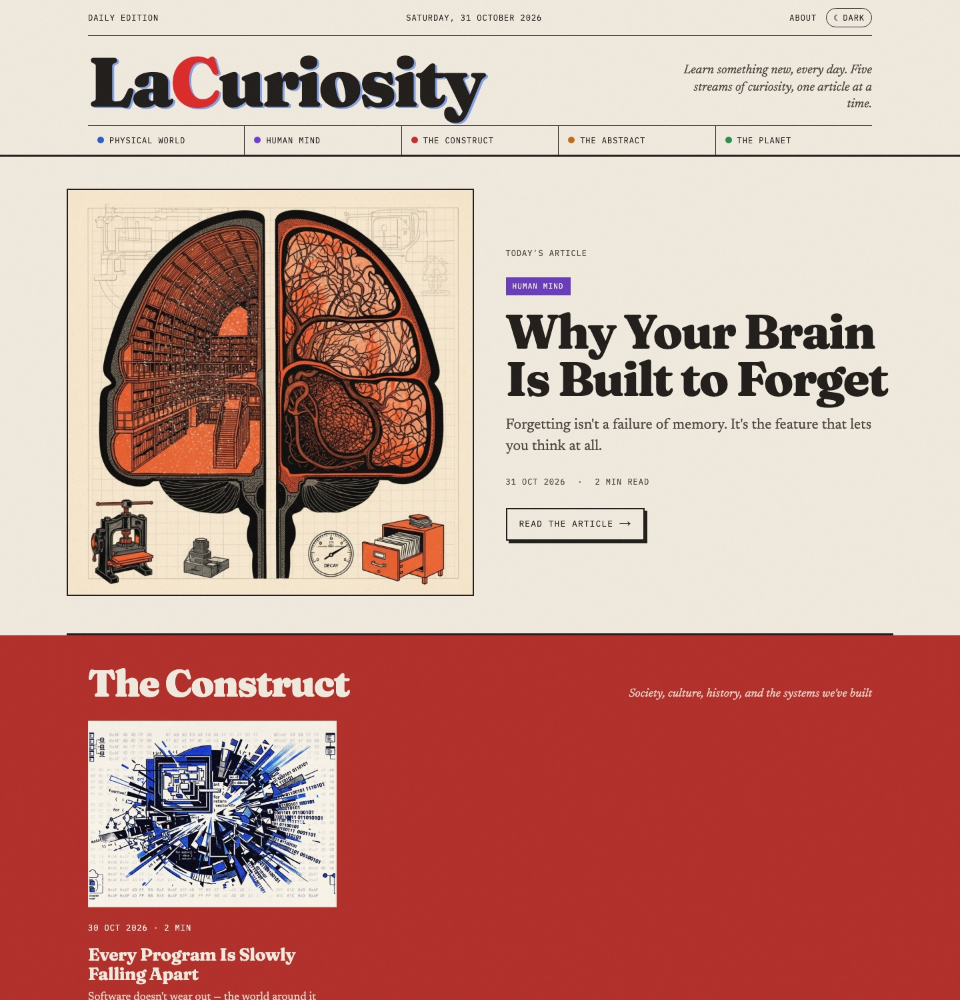
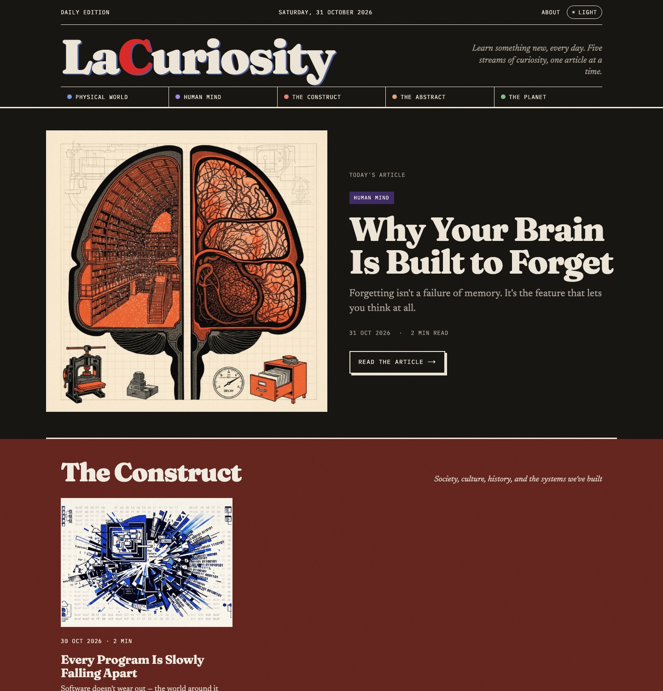
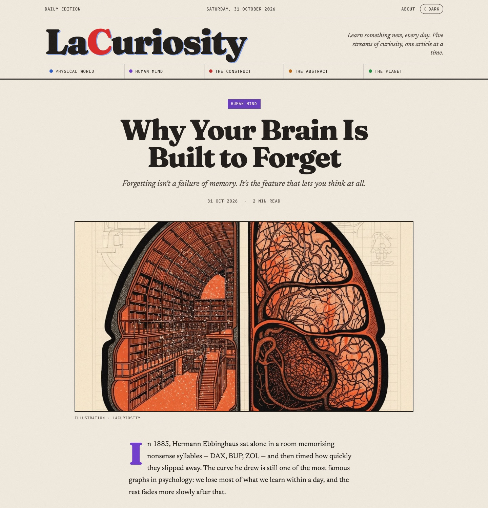
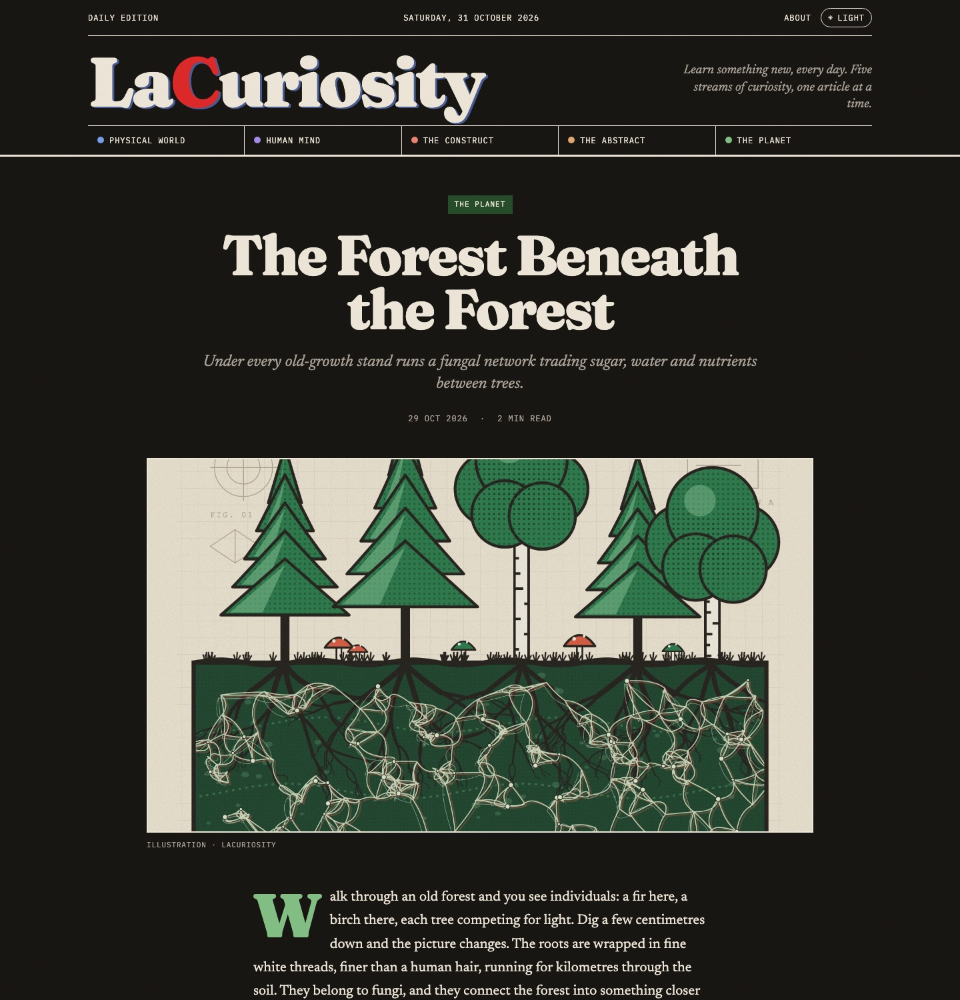
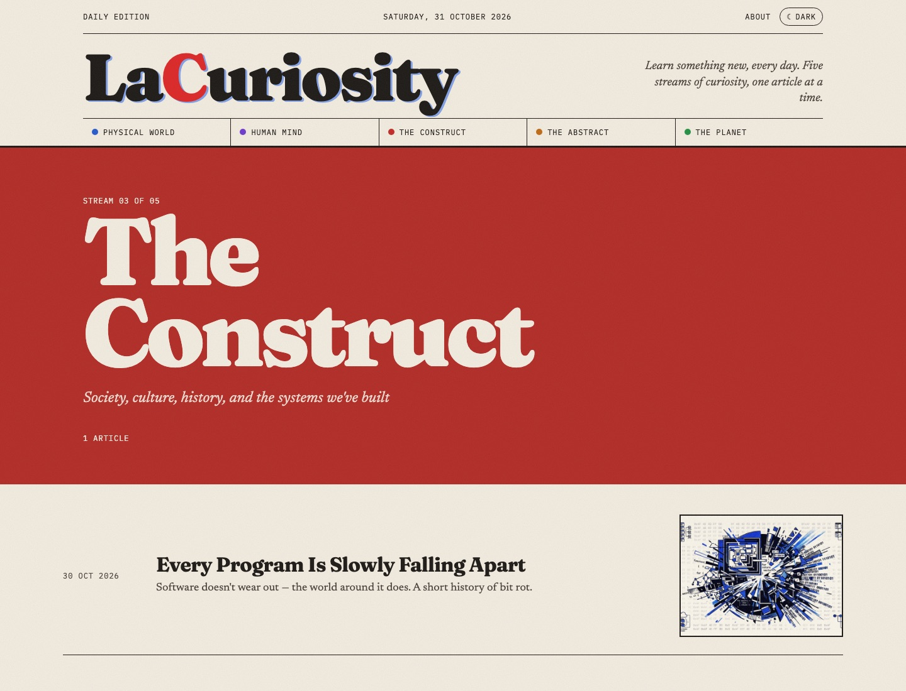
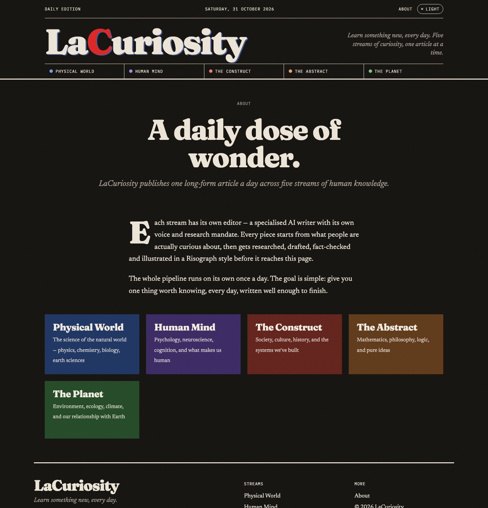
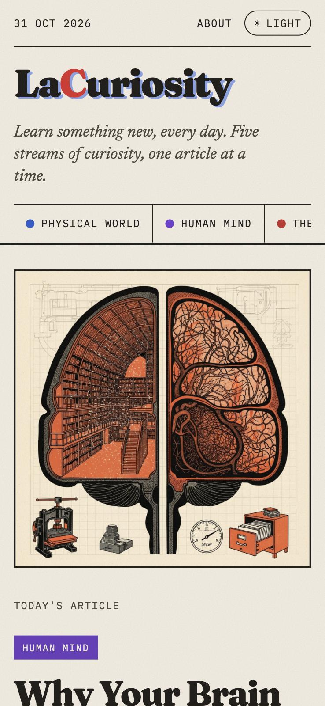
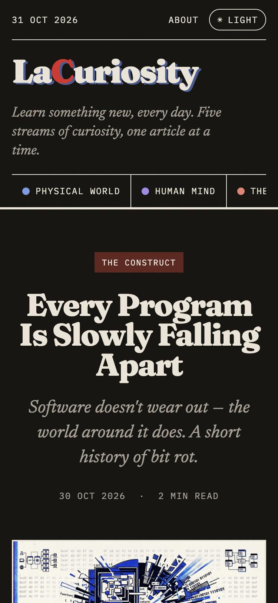
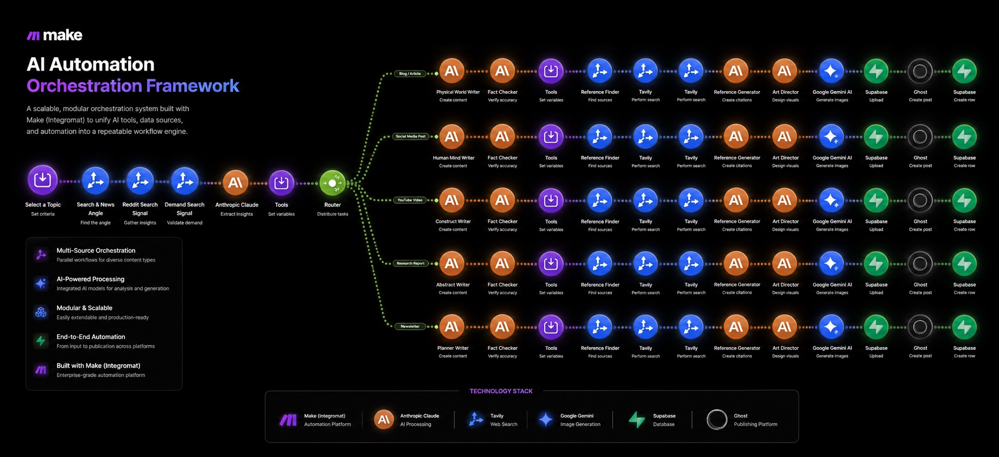

# LaCuriosity

**Learn something new, every day.**

LaCuriosity is a daily editorial publication: one long-form article a day across five streams of human knowledge, each written in its own voice and illustrated in a Risograph print style. This repository is the reading surface, a fast static website at **[lacuriosity.com](https://lacuriosity.com)** that looks and feels like a printed magazine.

The site is a Next.js static export hosted on GitHub Pages. There is no server, no database and no secret to manage: articles are Markdown files, and every page is plain HTML built ahead of time.

---

## What it does

- **Five streams of curiosity.** Physical World, Human Mind, The Construct, The Abstract and The Planet. Each has its own colour, page and voice.
- **A front page that reads like an edition.** Today's article leads as a full hero; below it, each stream gets a colour-blocked band with its latest pieces. Streams with nothing published yet say so ("First issue soon") without leaving a gap.
- **Long-form reading that respects the reader.** A 680px measure, a drop cap and pull quotes in the stream's colour, reading time, and "More curiosities" at the end.
- **Light and dark mode.** Follows the reader's OS by default; a ☾/☀ toggle overrides it and is remembered. The theme is applied before first paint, so there is never a white flash.
- **Risograph identity.** Paper grain, misregistered ink offsets on the masthead, halftone-dot covers when an article has no illustration, and solid "ink" blocks per stream.
- **Motion with restraint.** Press feedback, quiet hovers on pointer devices only, a one-time staggered entrance, and full `prefers-reduced-motion` support.
- **Publishing is a commit.** Drop a Markdown file into `content/articles/`, push, and the site rebuilds and redeploys in about a minute.

## Screenshots

<table>
  <tr>
    <td align="center"><br><sub><b>Front page · light</b></sub></td>
    <td align="center"><br><sub><b>Front page · dark</b></sub></td>
  </tr>
  <tr>
    <td align="center"><br><sub><b>Article</b></sub></td>
    <td align="center"><br><sub><b>Article · dark</b></sub></td>
  </tr>
  <tr>
    <td align="center"><br><sub><b>Stream page</b></sub></td>
    <td align="center"><br><sub><b>About · the five streams</b></sub></td>
  </tr>
  <tr>
    <td align="center"><br><sub><b>Phone · front page</b></sub></td>
    <td align="center"><br><sub><b>Phone · article, dark</b></sub></td>
  </tr>
</table>

## The content engine

The articles come from LaCuriosity's content engine, an AI orchestration workflow built on [Make](https://www.make.com). A single daily trigger picks a topic, gathers demand signals (search and news angles, Reddit, demand search), and has Claude extract the insights. A router then fans out into five parallel streams, one per pillar. Each stream runs the same chain: a writer persona drafts the piece, a fact checker verifies it, a reference finder and Tavily searches build citations, an art director briefs Gemini for the Risograph illustration, and the result is stored in Supabase and published.

<p align="center">
  
</p>

| Stage | What happens | Tools |
|---|---|---|
| Select | Choose the day's topic and the angle readers are searching for | Make, Tavily, Reddit |
| Understand | Extract insights from the research signals | Claude |
| Route | Distribute the work to the five pillar streams | Make router |
| Write and verify | A pillar-specific writer drafts; a fact checker verifies accuracy | Claude |
| Reference | Find sources and build citations | Tavily, Claude |
| Illustrate | An art director designs the visual; Gemini generates the Risograph cover | Claude, Gemini |
| Store and publish | Upload assets, create the post and record it | Supabase, publishing platform |

This website is the reading surface for that engine. Today articles arrive as Markdown files in this repo; connecting the engine to publish here directly is the first item on the [roadmap](docs/ARCHITECTURE.md#roadmap).

## Architecture in brief

Two boxes: **this repository** (content + code) and **GitHub** (Actions builds it, Pages serves it). Readers download static HTML, CSS, fonts and images; nothing runs on a server.

```
content/articles/*.md ─┐
content/pillars.ts ────┼─► next build (static export) ─► out/ ─► GitHub Pages ─► lacuriosity.com
public/covers/*.jpg ───┘          ▲
                                  └── GitHub Actions: push to main · daily 14:00 UTC · manual run
```

| Decision | Why |
|---|---|
| Static export, not a server-rendered app | A publication is read far more than it is written. Pre-built HTML is fastest for readers, indexable by search engines, and free to host. |
| Articles as Markdown in the repo | Publishing is a commit with a diff and a history. No database to provision, secure or pay for, and nothing to go wrong at request time. |
| One base colour per stream, tones derived in CSS | `color-mix` turns each stream's single hex value into a readable accent and a deep ink block, separately tuned for light and dark. Change one value and the whole site follows. |
| Theme set by an inline script before first paint | Without it, a dark-mode reader sees a white flash on every page load. |
| Covers optional, with a generated halftone fallback | The site never shows a broken image or an empty box when the illustration step hasn't run. |
| A single data module (`lib/data.ts`) | Pages never read files directly. Moving content into a database later changes one file, not every page. |
| No secrets at all | The build needs no API keys, so there is nothing to leak or rotate, and anyone can clone and run it. |

The full write-up covers how the site was built, every layer, the design system, what each choice costs, how it fails, and where it's headed:

**[docs/ARCHITECTURE.md](docs/ARCHITECTURE.md)**

## Tech stack

- **Framework:** Next.js 16 (App Router, `output: 'export'`), React 19, TypeScript (strict)
- **Styling:** Tailwind CSS v4 (reset and build pipeline) with a hand-written design system in `app/globals.css`
- **Type:** Fraunces (display), Newsreader (body), IBM Plex Mono (labels) via `next/font`, self-hosted at build time
- **Content:** Markdown with front matter, rendered by `marked`
- **Tests:** Vitest
- **Hosting:** GitHub Pages, deployed by GitHub Actions

## Repository layout

```
app/
  page.tsx                  Front page: today's article + one band per stream
  articles/[slug]/page.tsx  Article page
  pillar/[slug]/page.tsx    Stream page
  about/page.tsx            About
  not-found.tsx             404
  layout.tsx                Fonts, metadata, pre-paint theme script, masthead, footer
  globals.css               Design system: tokens, light/dark, riso effects, motion
components/                 Masthead, ThemeToggle, ArticleCard, Cover, Footer
content/
  articles/                 One Markdown file per article (filename = URL slug)
  pillars.ts                The five streams: name, slug, colour, description
lib/
  content.ts                Pure helpers: front matter, reading time, grouping, dates, Markdown
  data.ts                   The only module that knows where content lives
public/covers/              Article illustrations
docs/                       Architecture write-up, design spec, plan, UI mockup, screenshots
.github/workflows/          Build, test and deploy to GitHub Pages
```

Pages never read the filesystem. They go through `lib/data.ts`, which uses the pure helpers in `lib/content.ts`.

## Getting started

### Prerequisites

- Node.js 20 or newer and npm

### Run

```bash
npm install
npm run dev        # http://localhost:3000
```

No `.env` file is needed.

### Commands

| Command | Purpose |
|---|---|
| `npm run dev` | Dev server with hot reload |
| `npm test` | Run the Vitest suite |
| `npx tsc --noEmit` | Type-check |
| `npm run build` | Static export to `out/` |
| `npm start` | Serve `out/` locally, exactly as GitHub Pages will |

## Publishing an article

Create `content/articles/<slug>.md`:

```markdown
---
title: The Forest Beneath the Forest
pillar: the-planet
excerpt: One sentence shown under the headline and on cards.
cover: /covers/the-forest-beneath-the-forest.jpg
publishedAt: 2026-10-29T08:00:00Z
---

The article body in Markdown. ## Headings, **bold**, > pull quotes and lists are all styled.
```

| Field | Notes |
|---|---|
| `title` | The headline |
| `pillar` | One of `physical-world`, `human-mind`, `the-construct`, `the-abstract`, `the-planet`. An unknown value fails the build with a clear message. |
| `excerpt` | The standfirst under the headline and the line on cards |
| `cover` | Optional. Put a JPEG (about 1600px wide) in `public/covers/` and reference it as `/covers/<file>`. Leave it empty for the halftone cover. |
| `publishedAt` | ISO date. The newest article becomes the front-page hero. |

Push to `main`. The workflow tests, builds and deploys; the article is live in about a minute.

## Testing

Unit tests cover the pure content layer: front-matter parsing (including the unknown-stream error), reading time, grouping articles by stream (including empty streams), date formatting, and Markdown rendering. The build itself is the integration test: every route is generated at build time, so a malformed article fails the deploy instead of shipping a broken page. Visual QA (light/dark, desktop/phone, keyboard focus, reduced motion) was done by hand in the browser; there is no end-to-end suite.

## Deployment

[`.github/workflows/deploy.yml`](.github/workflows/deploy.yml) runs `npm ci`, `npm test` and `npm run build`, then publishes `out/` to GitHub Pages. It runs on every push to `main`, daily at 14:00 UTC (to keep the masthead date current), and on demand from the Actions tab.

One-time setup (repo admin):

1. **Settings → Pages → Source: GitHub Actions.**
2. **Custom domain.** `public/CNAME` already contains `lacuriosity.com`. At the domain registrar add:

   | Type | Host | Value |
   |---|---|---|
   | A | @ | 185.199.108.153 |
   | A | @ | 185.199.109.153 |
   | A | @ | 185.199.110.153 |
   | A | @ | 185.199.111.153 |
   | CNAME | www | rutvij-projects.github.io |

3. Once GitHub has issued the certificate, tick **Enforce HTTPS** under Settings → Pages.

## Project status

V1 is complete: every page, both themes, the design system and the deploy pipeline. It launches with three illustrated articles (Human Mind, The Construct, The Planet); Physical World and The Abstract show their "first issue soon" state until their first pieces land.

Next: connect the LaCuriosity content pipeline so articles arrive automatically rather than by commit, add an RSS feed and Open Graph cover images per article, and bring in the audio narration that the pipeline already produces. See the roadmap in [docs/ARCHITECTURE.md](docs/ARCHITECTURE.md#roadmap).

## Documentation

| Document | What it is |
|---|---|
| [docs/ARCHITECTURE.md](docs/ARCHITECTURE.md) | How the site was built: context, decisions, every layer, design system, failure modes, roadmap |
| [docs/superpowers/specs](docs/superpowers/specs) | Design spec |
| [docs/superpowers/plans](docs/superpowers/plans) | Implementation plan |
| [docs/mockup/index.html](docs/mockup/index.html) | The approved interactive UI mockup (open locally in a browser) |

## Author

Built by [Rutvij Dhotey](https://github.com/rutvijdhotey).
